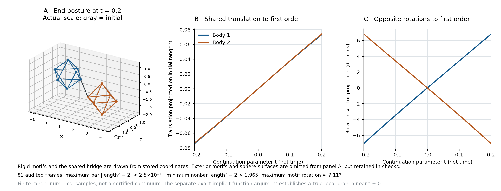

# A finite pair of moving rigid motifs inside a fixed exterior

The open skew configuration admits a local rigid-body mechanism even when every exterior motif is fixed. This folder supplies numerical continuation of a two-motif branch and an independent audit of its sampled frames. It also supplies exact negative controls at the vacancy endpoint.



## Model

The moving motif origins are lattice indices `(0,0,0)` and `(1,0,0)`. Each motif contains sites `P={±e_i}`. Its position and orientation have six degrees of freedom. Every exterior motif remains at its original position and orientation. All 11 incident designated bridges retain squared length 2, including the bridge between the moving motifs. Physical sphere radius is `1/sqrt(2)`.

The open configuration has

```text
L = 3I + C/sqrt(2),
C = [[0,-1,-1], [1,0,-1], [1,1,0]].
```

The numerical Jacobian has rank 11. Its nullvector agrees with the independently derived analytic tangent to within `1.7e-16`. At first order the two motifs have the same translation and opposite rotations. At finite displacement the translations and rotation vectors differ from those first-order relationships.

The exact rank and implicit-function argument are separate analytic results. They establish a true local continuum near the initial configuration. The sampled finite extent below is additional numerical evidence, not an interval certificate for the entire range.

## Finite sampled branch

There are 81 distinct stored frames, at continuation parameters `t=-0.2,-0.195,...,0.2`. The parameter fixes a phase in local rigid-motion coordinates. It is not physical time.

| Quantity | Observed bound |
|---|---:|
| Largest retained-bar squared-length residual | `2.45e-15` |
| Smallest nonbar squared-distance gap above 2 | `1.9652951555` |
| Largest motif-origin translation | `0.0741031063` |
| Largest rotation angle | `0.1240710901` radians, about `7.11°` |
| Smallest omitted-image distance lower bound | `3.8391739399` |
| Smallest sampled augmented-Jacobian singular value | `0.9600461437` |

Every moving/fixed sphere pair in the image cube `[-2,3]^3` is checked, together with all pairs between the two moving motifs. Rigid internal distances are preserved by construction. The retained bridges are separated from the nonbar clearance statistic.

For omitted images, skew symmetry gives `sigma_min(L)>=3`. Outside that cube, an integer image has norm at least 3. Therefore its distance from a moving site is at least `8-max_site_norm`, which exceeds `sqrt(2)` by a large margin throughout the stored frames. This supplies an analytic bound for omitted images. It does not turn the sampled temporal range into a certified continuum.

`finite_branch_audit.py` reconstructs rotations with Rodrigues' formula and rechecks all stored frames independently of SciPy's rotation implementation and the continuation code. Its central-difference Jacobians are diagnostics. No unsampled regularity theorem is inferred from them.

## Exact vacancy controls

At the vacancy endpoint, the same one- and two-motif patches have bar-only nullities one and two. Extra hard-sphere contacts block every first-order velocity compatible with those bars.

The saved certificate gives true contact pairs, strictly positive rational contact weights `w`, and rational bar multipliers `lambda`. The standard-library verifier reconstructs the geometry and establishes

```text
w^T A + lambda^T J = 0,
w > 0,
rank([A; J]) = 6m,
```

where `Jv=0` describes retained bars and `Av>=0` describes first-order nonpenetration. The weighted sum forces every contact derivative to vanish. Full rank then forces `v=0`.

This also proves local isolation of the vacancy packing for each specified patch. If distinct feasible configurations approached it, normalized displacement secants would have a subsequence converging to a nonzero velocity satisfying these first-order constraints. The zero cone rules that out. The claim is local, and it does not cover every finite patch or every distant real solution.

## Reproduce

```sh
python3 two_body_branch.py
python3 vacancy_stress_verify.py
python3 finite_branch_audit.py
python3 make_branch_figure.py
```

Run these commands from this folder. Continuation uses NumPy and SciPy. The vacancy verifier uses only the Python standard library. The optional figure uses Matplotlib. All output remains in this folder. No physical actuation, force, energy, or working joint is supplied.
