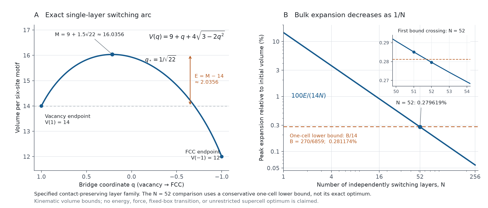

# Switching-volume figure



The left panel draws the proven switching arc, its maximum, and its excess above the vacancy endpoint. Here `q` is the moving-bridge coordinate, not the probe radius used in the passage work. The right panel shows the sequential layer construction's relative expansion `E/(14N)`, compared with the conservative one-cell lower bound `B/14`.

The inset shows why 52 is the first integer layer count where this particular upper bound falls below that particular lower bound. It does not establish the unrestricted supercell optimum or show that 52 layers are necessary for improvement. These are kinematic volume bounds, without energy or force claims.

The formulas come from the [layer proof at its published commit](https://github.com/Foundation-0/vitruvian3d/blob/a38ecc78910e4dc8dd8ed843ac7207341c0151a9/research/volume_layer_proof.md) and the [one-cell obstruction at its published commit](https://github.com/Foundation-0/vitruvian3d/blob/65afe245178d6d0da1b748a5d5f52be5a7d865f4/research/volume_barrier.md). Plot sampling draws the exact formulas; the cited proofs establish their scope.

Reproduce with Python and the pinned Matplotlib dependency:

```sh
python -m pip install -r visualizations/requirements.txt
python visualizations/make_switching_figure.py
```

Outputs are PNG, SVG, PDF, and a compact JSON record of the plotted constants and exact crossover checks. The script omits author and date metadata. It fixes SVG identifier hashing. Fonts and rendering libraries can still affect exported bytes.

[Archived initial interactive explainers](source/README.md) are separate historical illustrations.
